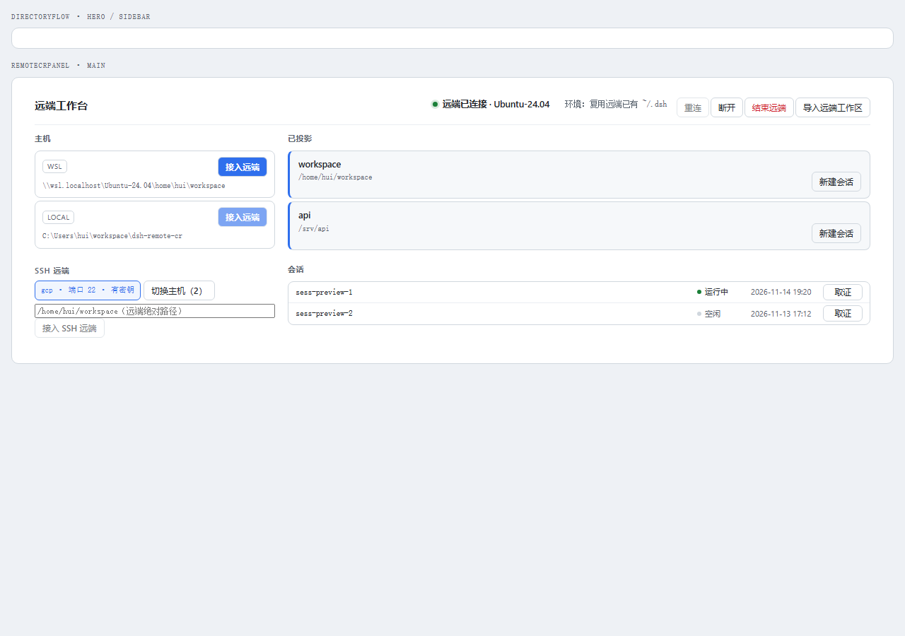

# dsh-remote-cr

[中文](./README.md) | **English**

[](https://github.com/CodingRookie98/dsh-remote-cr/actions/workflows/ci.yml)
[](./LICENSE)
[](./package.json)
[](./package.json)

Maintained by [@CodingRookie98](https://github.com/CodingRookie98) · [Changelog](./CHANGELOG.md) · [Troubleshooting](./docs/troubleshooting.md) · [ADRs](./docs/decisions/) · [Review archive](./docs/project/reviews/) · [Issues](https://github.com/CodingRookie98/dsh-remote-cr/issues)

> A remote-development plugin for DeepSeek Harness (DSH): **move the whole host to the remote (WSL2 / SSH) and keep only a native GUI plus the credentials on the local machine.**
>
> Shaped like VS Code Remote-SSH / Zed Remote — but what moves is not "commands", it is the agent runtime itself.



*Screenshots come from real CDP probes (1280×900), not mockups. Narrow layout: [panel-narrow.png](./docs/assets/panel-narrow.png); workspace wizard: [host-wizard.png](./docs/assets/host-wizard.png).*

## Why this exists

Most remote plugins in the DSH marketplace are **type A (remote execution)**: the agent, plugins, sessions and model calls stay local and only command/file IO is dispatched to the remote. This project is **type B (remote host)**:

| | Type A: remote execution | Type B: remote host (this project) |
|---|---|---|
| agent loop / tools / sessions | local | **remote** |
| Remote DSH plugins usable by the agent | no | **yes** |
| Tasks keep running after the local GUI closes | no | **yes** (`keepAlive`, the same instance is reused on reconnect) |
| Where the real API key lives | local | **local** (the remote only holds placeholder tokens; calls come back through a reverse tunnel) |

## Features

**Workspace entry** — takes over the official `directoryFlow` (both the sidebar and the empty-conversation holes), keeping a single native GUI
- Modal two-pane layout: sources on the left (local / WSL distros / SSH remotes / Docker), the directory browser on the right
- Breadcrumbs + editable path + go-up + refresh; `↑ ↓` move, `Enter` enters, `Backspace` goes up, `/` focuses the path field, `Esc` closes
- Unavailable sources are greyed out with the reason and a copyable fix command (for example `wsl --install`); Docker is an M5 item and is greyed out today

**WSL**
- Wake before browsing: `wsl.exe -d <distro> --exec true` must pass before the directory browser opens; on failure it stays put and shows a diagnosis card instead of dropping you into the directory page
- The card carries the error code, a plain-language explanation, the raw `Error code:` line, next actions and a copyable full report; cold-start timeouts get their own `wsl/timeout` code
- Waking is cancellable: client `abort` → host `close` → kill `wsl.exe`, so no orphan process lingers until the timeout

**SSH and projection**
- Fill in a target on the panel and attach: the workspace is registered on the remote and its sessions are projected into the local list, in the same view as local workspaces
- Automatic reconnect (2s / 4s / 8s ×3, then back off to every 2 minutes); "Stop remote" explicitly reaps the remote process
- Import workspaces the remote already has: list importables → select → register

**General**
- Credentials never leave the machine: the remote only holds placeholder tokens
- Failures are always structured (`code` + `detail` + `nextActions`), copyable, retryable, never silently degraded

## Requirements

| Component | Supported range |
|---|---|
| DSH host | `>=0.2.1-rc.0 <0.3.0` (`package.json#engines.dsh`) |
| Node | `^22.19.0` or `>=24.0.0` |
| Local machine | Windows 10/11 with WSL2 or an OpenSSH client |
| Remote | Linux (POSIX shell + `node`; the first attach needs dsh installed on the remote, which the installer can do) |

## Install

```bash
# Pinned version (recommended)
dsh plugin --profile web add 'github:CodingRookie98/dsh-remote-cr#v0.4.0'

# Or link a local checkout (development)
dsh plugin --profile web add 'dsh-remote-cr@link:D:/workspace/projects/dsh-remote-cr'
```

Restart `dsh web` (or DSH Desktop) afterwards; the "Remote Workbench" entry appears in the sidebar. The package is `private: true` and ships through GitHub tags / local links, not npm publish.

> The marketplace card blurb comes from the community catalog [awesome-dsh-plugin](https://github.com/awesome-dsh-plugin/awesome-dsh-plugin). Our submission is prepared ([docs/release/market-listing.md](./docs/release/market-listing.md)); until it merges, the card shows only the package name and link.

## Upgrading from 0.3.0 to 0.4.0

0.4.0 is **breaking**: every runtime identifier was renamed ([ADR-0006](./docs/decisions/ADR-0006-rename-runtime-identifiers.md)).

| Surface | 0.3.0 | 0.4.0 |
|---|---|---|
| Local state root | `~/.dsh-teleport` | `~/.dsh-remote-cr` |
| Environment variables | `DSH_TELEPORT_*` | `DSH_REMOTE_CR_*` |
| API prefix | `/teleport/api` | `/remote-cr/api` |
| DOM hooks | `data-teleport` | `data-remote-cr` |
| cordis row id | `teleport` | `remote-cr` |

Three steps:

1. **Delete the old patch row by hand**: edit the profile's `cordis.patch.yml`, remove the `- id: teleport` row, then restart the host — there is no automatic cleanup job;
2. **Stop the old instance first**: if a 0.3.0 dsh is still running on the remote, use "Stop remote" in the panel first, otherwise the new local host starts a second one and hits `remote/port-in-use`;
3. **Local state migrates itself**: the first start **copies** `known_hosts` / `hostkeys.json` into the new root (copy only, never delete; rollback = remove the new root).

**Not migrated**: local `anchors/`, `staging/`, remote `instances/`, `staging/` — consequences and manual steps in [ADR-0006 §3.5](./docs/decisions/ADR-0006-rename-runtime-identifiers.md).

## Configuration

| Variable | Meaning | Default |
|---|---|---|
| `DSH_REMOTE_CR_REMOTE_ROOT` | Remote dsh checkout root (empty = let the bootstrapper install dsh into `~/.dsh-remote-cr/staging`) | empty |
| `DSH_REMOTE_CR_PORT` | Port the remote dsh listens on | `8899` |
| `REMOTE_CR_ENV_POLICY` | Environment policy: `reuse` / `isolated` (`sync` is rejected; lands in M3) | `reuse` |

Legacy names (`DSH_TELEPORT_*`) are still read with a one-time warning and are **removed in 0.5.0**; setting both with different values makes the attach fail with `remote/env-conflict` instead of guessing.

## Usage

1. **Attach a remote**: open the "Remote Workbench" panel → fill in an SSH target (or pick a WSL distro) → attach. The first attach shows staged bootstrap progress and can be cancelled.
2. **Add a workspace**: click the official "Add workspace", or the add entry on the panel → pick a source on the left → pick a directory on the right → "Add this directory".
3. **Run long tasks**: sessions run on the remote and keep running after the local window closes; on return the same instance is reused and session ids do not change.

## How it works

```
local GUI ──(projection / control)──▶ local host half ──(SSH tunnel / WSL invocation)──▶ remote dsh host
   │                                     │                                                  │
   └── credential proxy ◀────────────────┘        agent loop / plugins / sessions ◀──────────┘
```

- Four entry points, one repository: `./local` (local host half), `./client` (browser half), `./companion` (remote companion), `./installer` (bootstrap)
- The host half serves `/remote-cr/api/*` (source probing, directory browsing, waking, projection, attach and disconnect) and answers loopback only
- **Naming**: package name, plugin id and runtime identifiers are all `remote-cr` — `~/.dsh-remote-cr`, `DSH_REMOTE_CR_*`, `/remote-cr/api`, the `data-remote-cr` DOM attributes and the `cordis.patch.yml` row id are one and the same name ([ADR-0006](./docs/decisions/ADR-0006-rename-runtime-identifiers.md)). Compatibility reads for the old `dsh-teleport` name are confined to `src/local/migration/` and are removed in 0.5.0
- **UI languages**: Chinese and English, following Settings → General → Language and switching without a reload; other languages fall back to English

## Development

```bash
pnpm install
pnpm typecheck                     # host half + browser half, two tsconfigs
pnpm test                          # node --test (676 tests)
pnpm check:cjk                     # UI-copy gate: no hard-coded Chinese in client/shared
pnpm check:boot                    # boot fragility: patch row id / dsh manifest / legacy names
pnpm check:errors                  # error-code index matches the dictionaries
pnpm check:docs                    # doc images: exist, real PNG, minimum size
pnpm doctor                        # can the installed package load (entries/exports/client/patch/state root)
pnpm build && pnpm build:client    # lib/ is committed; rebuild after touching sources
```

The two browser-side e2e suites need a real Chrome and are **not** in CI; run them locally:

```bash
pnpm e2e:preview    # scenario screenshots + keyboard path (headless Chrome)
pnpm e2e:host       # real machine: isolated DSH_HOME + real dsh web + real Chrome (needs Windows + WSL2)
```

Collaboration rules, commit layering and the definition of done live in [`AGENTS.md`](./AGENTS.md) (Chinese).

## Layout

```
src/
  client/      browser half: panel, add-workspace wizard, state machine, styles
  local/       host half: routes, directory browsing, WSL/SSH backends, projection, credential proxy
  shared/      contracts shared by both halves (one wire shape only)
  companion/   remote companion
  installer/   bootstrap
scripts/       build scripts and the preview harness
spikes/        executable probes (CDP / path semantics / cross-machine reverse path)
lib/           compiled output (committed, submitted separately from sources)
docs/          research, design, decisions, plans and review archives
```

## Docs

- [Documentation index](./docs/README.md) · **[Troubleshooting](./docs/troubleshooting.md)** (symptom-first, with an index of all error codes)
- Design: [requirements](./docs/design/requirements.md) · [architecture](./docs/design/architecture.md) · [UI design](./docs/design/ui-design.md) · [milestones](./docs/design/milestones.md)
- Decisions: [ADR-0001](./docs/decisions/ADR-0001-host-on-remote.md) (type B) · [ADR-0003](./docs/decisions/ADR-0003-embedding-strategy.md) (embedding route) · [ADR-0004](./docs/decisions/ADR-0004-plugin-sync.md) (plugin sync) · [ADR-0005](./docs/decisions/ADR-0005-workspace-entry-ui.md) (workspace entry) · [ADR-0006](./docs/decisions/ADR-0006-rename-runtime-identifiers.md) (naming) · [ADR-0007](./docs/decisions/ADR-0007-i18n-layering.md) (bilingual layering)
- Reviews: [eight adversarial review rounds for 0.4.0](./docs/project/reviews/2026-11-15-remote-cr-rename-i18n-ui/)
- Research: [architecture models](./docs/research/01-architecture-models.md) · [competitive landscape](./docs/research/05-ecosystem-and-value-2026-11.md) · [DSH extension points and hard limits](./docs/research/04-dsh-extension-points.md)

## Known limitations

- **Docker**: greyed out in the UI; implementation is scheduled for M5
- **No version probe**: an old remote plus a new local host looks like `remote/port-in-use` (`remote/version-mismatch` does not exist)
- **WSL cannot keep alive**: when the `wsl.exe` handle exits, distro-side children go with it (`keepAlive` is an optional capability)
- **Cancellation is tiered**: `probe/bootstrap/launch/tunnel` are cancellable; `attach` RPC is best effort
- **Browsers**: verified on Chrome only; Edge / Firefox / WebKit are unverified
- **Accessibility**: screen-reader paths are unverified (`radiogroup` / `listbox` semantics and the keyboard path are implemented and asserted)
- **Real-machine latencies**: the success-path timing distribution for waking is not measured; only failure classification and timeout semantics have real-machine evidence

## Contributing

Make sure `pnpm typecheck` and `pnpm test` are green before committing; commit `lib/` output separately (see `AGENTS.md` §4). Open an issue first for contract or architecture changes.

## License

[MIT](./LICENSE) © 2026 dsh-remote-cr contributors
