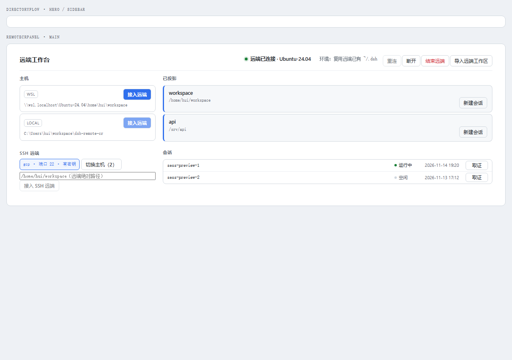

# dsh-remote-cr

**中文** | [English](./README.en.md)

[](https://github.com/CodingRookie98/dsh-remote-cr/actions/workflows/ci.yml)
[](./LICENSE)
[](./package.json)
[](./package.json)

由 [@CodingRookie98](https://github.com/CodingRookie98) 维护 · [更新日志](./CHANGELOG.md) · [排查手册](./docs/troubleshooting.md) · [决策记录](./docs/decisions/) · [审查归档](./docs/project/reviews/) · [Issue](https://github.com/CodingRookie98/dsh-remote-cr/issues)

> DeepSeek Harness（DSH）的远程开发插件：**把整个宿主搬到远端（WSL2 / SSH），本地只留一个原生 GUI 和钥匙。**
>
> 形态对标 VS Code Remote-SSH / Zed Remote —— 但搬过去的不是「命令」，是 agent 运行时本身。



*截图来自真机 CDP 探针（1280×900），不是示意图。窄屏单列见 [panel-narrow.png](./docs/assets/panel-narrow.png)，添加工作区向导见 [host-wizard.png](./docs/assets/host-wizard.png)。*

## 为什么需要它

DSH 插件市场里的远程插件多为 **A 型（远端执行）**：agent、插件、会话、模型调用都在本地，只把命令与文件 IO 派发到远端。本项目是 **B 型（宿主远端）**：

| | A 型：远端执行 | B 型：宿主远端（本项目） |
|---|---|---|
| agent loop / 工具 / 会话 | 本地 | **远端** |
| 远端已装的 DSH 插件能被 agent 使用 | 否 | **是** |
| 关掉本地 GUI 后任务是否继续 | 否 | **是**（`keepAlive`，重连复用同一实例） |
| 真实 API key 落在哪 | 本地 | **本地**（远端只有占位令牌，调用经反向隧道回来替换） |

## 功能

**工作区入口** —— 占位官方 `directoryFlow`（侧栏与会话空态两个洞同时接管），保持单一原生 GUI
- 模态双栏：左栏来源（本机 / WSL 发行版 / SSH 远端 / Docker），右栏目录浏览器
- 面包屑 + 可编辑路径 + 上一级 + 刷新；`↑ ↓` 移动、`Enter` 进入、`Backspace` 上一级、`/` 跳路径框、`Esc` 关闭
- 不可用来源灰显并写明原因，修复命令一键复制（如 `wsl --install`）；Docker 为 M5 计划项，当前灰显

**WSL**
- 先唤醒再浏览：`wsl.exe -d <distro> --exec true` 探测通过才进目录；失败留在原地给诊断卡，不会把人丢进目录页
- 诊断卡包含错误码、人话说明、`Error code:` 原文、下一步与可复制的完整报告；冷启动超时单列 `wsl/timeout`
- 唤醒可取消：客户端 `abort` → 宿主 `close` → kill `wsl.exe`，不留跑满超时的孤儿进程

**SSH 与投影**
- 面板填目标并接入：远端注册工作区、投影会话回本地列表，与本地工作区同视图
- 断线自动重连（2s / 4s / 8s ×3 后退避到 2 分钟）；「结束远端」显式收掉远端进程
- 导入远端已有工作区：列出可导入项 → 选择 → 注册

**通用**
- 凭据不出本机：远端只持有占位令牌
- 失败一律结构化（`code` + `detail` + `nextActions`），可复制、可重试，不静默降级

## 要求

| 组件 | 支持范围 |
|---|---|
| DSH 宿主 | `>=0.2.1-rc.0 <0.3.0`（`package.json#engines.dsh`）；已实测 **0.2.2-rc.4**（WSL 7/7、SSH 11/11） |
| Node | `^22.19.0` 或 `>=24.0.0` |
| 本机 | Windows 10/11，WSL2 或 OpenSSH 客户端 |
| 远端 | Linux（POSIX shell + `node`；首次接入需在远端安装 dsh，可由引导器代做） |

## 安装

```bash
# 固定版本（推荐）
dsh plugin --profile web add 'github:CodingRookie98/dsh-remote-cr#v0.4.0'

# 或链接本地检出（开发）
dsh plugin --profile web add 'dsh-remote-cr@link:D:/workspace/projects/dsh-remote-cr'
```

装完重启 `dsh web`（或 DSH Desktop），侧栏出现「远端工作台」即可使用。本包 `private: true`，通过 GitHub tag / 本地 link 分发，不走 npm publish。

> 插件市场的卡片简介来自社区目录 [awesome-dsh-plugin](https://github.com/awesome-dsh-plugin/awesome-dsh-plugin)，我们已备好投稿材料（[`docs/release/market-listing.md`](./docs/release/market-listing.md)）；投稿合并前，市场里这张卡片只会显示包名与链接。

## 从 0.3.0 升级到 0.4.0

0.4.0 是**破坏性**版本：运行时标识全量改名（见 [ADR-0006](./docs/decisions/ADR-0006-rename-runtime-identifiers.md)）。

| 面 | 0.3.0 | 0.4.0 |
|---|---|---|
| 本地状态根 | `~/.dsh-teleport` | `~/.dsh-remote-cr` |
| 环境变量 | `DSH_TELEPORT_*` | `DSH_REMOTE_CR_*` |
| API 前缀 | `/teleport/api` | `/remote-cr/api` |
| DOM 断言面 | `data-teleport` | `data-remote-cr` |
| cordis 行 id | `teleport` | `remote-cr` |

升级三步：

1. **手工删掉旧补丁行**：编辑 profile 的 `cordis.patch.yml`，删掉 `- id: teleport` 那一行后重启宿主 —— 没有自动清理程序；
2. **先结束旧实例**：远端还跑着 0.3.0 的 dsh 时，先在面板「结束远端」，否则新本地会二次启动并撞端口（`remote/port-in-use`）；
3. **本地状态自动迁移**：首次启动把 `known_hosts` / `hostkeys.json` **复制**到新根（只复制不删除，回滚 = 删新根）。

**不迁移项**：本地 `anchors/`、`staging/`，远端 `instances/`、`staging/` —— 后果与手工操作见 [ADR-0006 §3.5](./docs/decisions/ADR-0006-rename-runtime-identifiers.md)。

## 配置

| 环境变量 | 作用 | 默认 |
|---|---|---|
| `DSH_REMOTE_CR_REMOTE_ROOT` | 远端 dsh 检出根（留空则走引导器把 dsh 装进 `~/.dsh-remote-cr/staging`） | 空 |
| `DSH_REMOTE_CR_PORT` | 远端 dsh 监听端口 | `8899` |
| `REMOTE_CR_ENV_POLICY` | 环境档位：`reuse` / `isolated`（`sync` 明确拒绝，M3 才落地） | `reuse` |

旧名（`DSH_TELEPORT_*`）仍可读，读取时告警一次，**0.5.0 移除**；新旧同时设置且值不同时，接入会以 `remote/env-conflict` 失败 —— 不替你选。

## 使用

1. **接入远端**：打开「远端工作台」面板 → 填 SSH 目标（或选 WSL 发行版）→ 接入。首次会分阶段显示引导进度，可取消。
2. **添加工作区**：点官方「Add workspace」，或面板里的添加入口 → 左栏选来源 → 右栏选目录 → 「添加此目录」。
3. **跑长任务**：会话运行在远端，关掉本地窗口任务继续；回来时重连复用同一实例，会话 id 不变。

## 工作原理

```
本地 GUI ──(投影 / 控制)──▶ 本地宿主半 ──(SSH 隧道 / WSL 调用)──▶ 远端 dsh 宿主
   │                          │                                      │
   └── 凭据代理 ◀─────────────┘          agent loop / 插件 / 会话 ◀───┘
```

- 四个入口，同一仓库：`./local`（本地宿主半）、`./client`（浏览器半）、`./companion`（远端伴生）、`./installer`（引导器）
- 宿主半提供 `/remote-cr/api/*` 路由（来源探测、目录浏览、唤醒、投影、接入与断连），全部只答本机回环
- **插件同步**：远端缺的第三方插件由**远端原生安装**（ADR-0004，不搬文件）；SSH 走 `ssh host sh -c`，WSL 走 `wsl.exe -d <distro> --exec sh -c`，并在安装期间**保持句柄**（方案 A，见 [契约 §7](./docs/design/plugin-sync-contract.md)）
- **命名**：包名、插件 id 与运行时标识统一为 `remote-cr` —— `~/.dsh-remote-cr`、`DSH_REMOTE_CR_*`、`/remote-cr/api`、`data-remote-cr` DOM、`cordis.patch.yml` 行 id 是同一个名字（[ADR-0006](./docs/decisions/ADR-0006-rename-runtime-identifiers.md)）。旧版曾用名 `dsh-teleport` 的兼容读取集中在 `src/local/migration/`，0.5.0 移除
- **界面语言**：中文与英文（跟随 设置 → 通用 → 语言，即时切换；其余语言回落英文）

## 开发

```bash
pnpm install
pnpm typecheck                     # 宿主半 + 浏览器半双 tsconfig
pnpm test                          # node --test（750 条）
pnpm check:cjk                     # 界面文案门禁：客户端/共享层不许再写死中文
pnpm check:boot                    # 启动脆弱性：补丁行 id / dsh 三件套 / 旧名残留
pnpm check:errors                  # 错误码索引与字典一致（改了字典要 pnpm gen:errors）
pnpm check:docs                    # 文档图片：存在、真 PNG、尺寸下限
pnpm build && pnpm build:client    # lib/ 是入库产物，改源码后必须重建
pnpm doctor                        # 装好的包能不能加载（入口/导出/浏览器半/补丁/状态根）
```

浏览器侧验收需要真 Chrome，**不进 CI**，本地跑（17 个场景 + 键盘链路）：

```bash
pnpm e2e:preview    # 场景截图 + 键盘链路（Chrome headless）
pnpm e2e:host       # 真机：隔离 DSH_HOME + 真 dsh web + 真 Chrome（需 Windows + WSL2）
```

协作规则、提交分层与验收口径见 [`AGENTS.md`](./AGENTS.md)。

## 目录

```
src/
  client/      浏览器半：面板、添加工作区向导、状态机、样式、i18n 字典
  local/       宿主半：路由、目录浏览、WSL/SSH 后端、投影、凭据代理、状态根迁移
  shared/      两侧共享契约与纯逻辑（线上形状只有一份，只产出 id 不产出文案）
  types/       可执行门禁脚本的最小类型声明
  companion/   远端伴生
  installer/   引导器
scripts/       构建脚本、预览 harness、界面文案门禁
spikes/        可执行探针（CDP / 路径语义 / 跨机反向通路 / SSH 真机）
lib/           编译产物（入库，与源码分开提交）
docs/          调研、设计、决策、计划与审查归档
```

## 文档

- [文档索引](./docs/README.md) · **[排查手册](./docs/troubleshooting.md)**（按症状查，含 73 个错误码索引）
- 设计：[需求与验收标准](./docs/design/requirements.md) · [总体架构](./docs/design/architecture.md) · [UI 设计](./docs/design/ui-design.md) · [里程碑](./docs/design/milestones.md)
- 决策：[ADR-0001](./docs/decisions/ADR-0001-host-on-remote.md)（B 型）· [ADR-0003](./docs/decisions/ADR-0003-embedding-strategy.md)（嵌入路线）· [ADR-0004](./docs/decisions/ADR-0004-plugin-sync.md)（插件同步）· [ADR-0005](./docs/decisions/ADR-0005-workspace-entry-ui.md)（工作区入口）· [ADR-0006](./docs/decisions/ADR-0006-rename-runtime-identifiers.md)（命名）· [ADR-0007](./docs/decisions/ADR-0007-i18n-layering.md)（双语分层）· [ADR-0008](./docs/decisions/ADR-0008-drop-docker-backend.md)（Docker 取消）
- 调研：[架构模型判定](./docs/research/01-architecture-models.md) · [竞品与生态](./docs/research/05-ecosystem-and-value-2026-11.md) · [DSH 扩展点与硬限制](./docs/research/04-dsh-extension-points.md)
- 审查：[0.4.0 的八轮对抗审查归档](./docs/project/reviews/2026-11-15-remote-cr-rename-i18n-ui/)

## 已知限制

- **Docker**：**已取消**（2026-11-19，[ADR-0008](./docs/decisions/ADR-0008-drop-docker-backend.md)）——四选一里仍灰显「暂不支持」以保持既有选择契约，不交付可用链路
- **宿主版本不一致只有 registry 一条路**：同步对话框会显示「本地 x / 远端 y」并允许把远端升到本地版本（`dsh plugin` 之外的另一条动作，**装完要重连才生效**）；
  远端跑**检出**、或本地是**未发布的开发构建**时明确拒绝并给原因（`checkout-mode` / `host-version-unavailable`），不做检出切换与文件搬运
- **没有自动版本对齐**：跨 `engines.dsh` 区间的升级一律拒绝（`out-of-range`），且升级永远不会自动发生
- **WSL 后端不支持驻留**：`wsl.exe` 句柄一退就把 distro 侧子进程带走（`keepAlive` 是可选能力）
- **WSL 插件同步期间别关面板/退应用**：安装跟着 `wsl.exe` 句柄走，句柄一断远端安装会被一起中断（`dsh plugin add` 幂等，重跑安全；UI 已当面提示）
- **取消是分级的**：`probe/bootstrap/launch/tunnel` 保证可取消；`attach` RPC 尽力而为
- **浏览器**：只在 Chrome 上验证；Edge / Firefox / WebKit 未验证
- **无障碍**：读屏路径未验证（`radiogroup` / `listbox` 语义与键盘链路已实现并有断言）
- **真机时延**：唤醒成功路径的耗时分布未统计，只有失败归类与超时口径的真机证据

## 贡献

提交前确保 `pnpm typecheck`、`pnpm test`、`pnpm check:cjk` 全绿；`lib/` 产物单独提交（见 [`AGENTS.md`](./AGENTS.md) `4）。涉及契约或架构的改动先开 issue 讨论。

## 许可证

[MIT](./LICENSE) © 2026 dsh-remote-cr contributors
