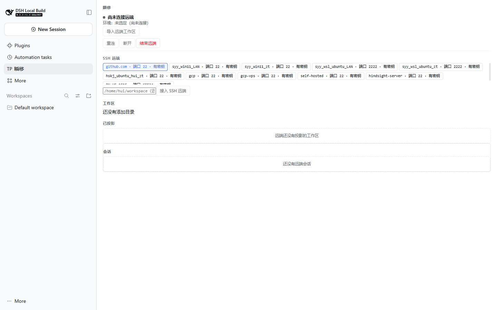
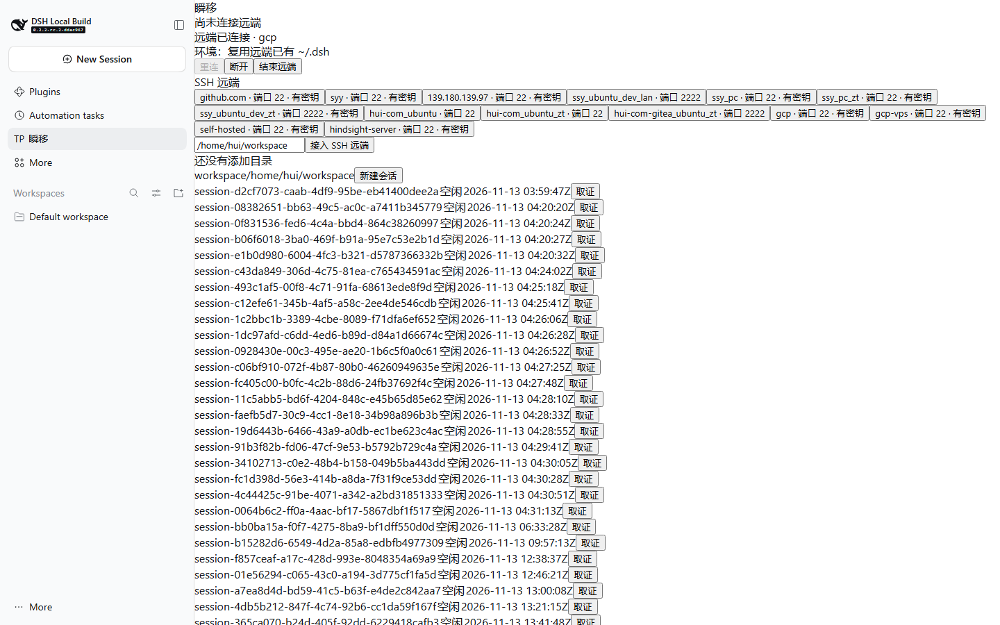
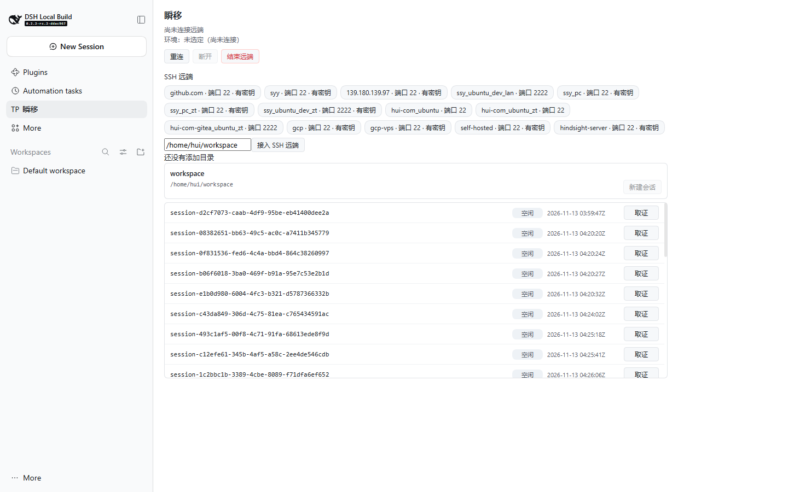

# dsh-remote-cr · 瞬移

[](https://github.com/CodingRookie98/dsh-remote-cr/actions/workflows/ci.yml)

> **把整个 DeepSeek Harness 宿主「瞬移」到远端（WSL2 / SSH），而 GUI 仍然只有一个原生 DSH。**
>
> 对标 VS Code Remote-SSH / Zed Remote / ZCode 远程开发：远端跑完整 agent 运行时（宿主、插件、会话、文件），本地只做呈现与凭据代理。

- 项目名：**dsh-remote-cr**（曾用名 `dsh-teleport` / 中文代号「瞬移」；2026-11-13 改名）
- **命名分层**：包名与插件 id 是 `dsh-remote-cr`；**运行时标识保留 `teleport`**（`~/.dsh-teleport` 锚点与 staging、`DSH_TELEPORT_*` 环境变量、`/teleport` API 前缀、`data-teleport` DOM 属性）—— 改名不该作废既有锚点、staging 与已部署的环境变量
- 状态：**M0 已关闭**（2026-10-31）；**M1（WSL）与 M2（SSH）已交付**——两条链路的 A1–A8 均有真机证据（560 条单测 + 7 套带负控的真机探针），**2026-11-13 按「有条件签署」放行**（A5 的取消能力分级、已知限制与未验证清单见 [`签署归档`](./docs/project/reviews/2026-11-13-m2-exit-signoff/README.md)）；**M3 进行中**：长任务闭环已打通——`keepAlive` 让远端 dsh 在本地退出后继续跑，重连**复用同一实例**（真机 `sameInstance:true`、会话 id 不变），M3-1 的取消状态机也已形式化；**M3-3 发布材料已备好**（安装段、兼容矩阵、真机截图、[上架材料](./docs/release/plugin-listing.md)），剩公开仓库与上架两步人工（见 [`2026-11-13-m3-long-task.md`](./docs/project/plans/2026-11-13-m3-long-task.md)）；**M4 已开工**：导入远端已有工作区真机 2/2（`GATE=import`、21 条目列表），并在**一台全新 WSL Ubuntu** 上跑通完整链路（干净机器 attach **4.4 s**、`stopRemote` **269 ms**、重连同 pid），顺带修掉 5 处「只在新机器上才会犯」的引导假设
- 目标平台：Windows 上的 DSH Desktop / dsh web + 本机 WSL2 发行版 / 任意 POSIX SSH 主机
- 后端交付顺序：**WSL2（M1）→ SSH（M2）→ Docker（M5）**
- 非目标（v1）：完整 IDE（LSP/Monaco）、多人协作、headless-only 部署；Docker 可用链路排到 M5

---

## 为什么做这个

用户的原始诉求是「在 Windows 的 DSH GUI 里，用上 WSL 里的开发环境」——包括 WSL 里为 dsh 装的插件、工具链、配置。调研与实测得出了两个关键结论：

1. **社区现有的 WSL/SSH 插件绝大多数是「远端执行」模型（A 型）**：宿主、插件、会话、模型调用全留在 Windows，只把 bash 与文件读写派发到远端。因此 WSL 里 `~/.dsh` 的插件（例如 hindsight）**永远不会被加载**。
2. **「宿主在远端」模型（B 型）的底层已经被证明可行**：`dsh-ssh-workspace`（SSH，iframe + companion）、`dsh-remote-explorer`（SSH + WSL，远端装 dsh + 隧道 + 反向凭据代理）、官方 Tauri 桌面内置 remote。我们实测跑通了 `dsh-remote-explorer` 的 WSL 链路：远端 dsh 0.2.1-rc.2 在 WSL 内运行，模型推理经反向隧道回到本机完成（真实 key 不出本机）。

但 **B 型现有实现的「集成层」都不够丝滑**：独立网页/浮动窗口、首次连接要下载约 1.4 GB、隔离的 DSH_HOME 导致远端已有插件/技能/配置不共享、账号/用量面板被上游 WAF 拦、本地与远端两套会话/历史。这正是本项目的切入点：**B 型的底层 + A 型/native 的集成体验**。

### 和 A 型「远程执行」插件的区别

| 能力 | A 型（DSH 插件市场现有 8 个） | **dsh-remote-cr（B 型）** |
|---|---|---|
| agent loop / 工具 / 会话在哪 | 本地 | **远端** |
| 远端要装什么 | 零安装 | dsh 宿主（首次引导约 1.4 GB / ~3 分钟） |
| 远端已装的插件能被 agent 用吗 | 不能（插件在本地） | **能**（真机：远端工具表 32→38） |
| 断网 / 关电脑后任务还活着吗 | 不能 | **能**（2s 档自动重连 18340 ms 连回） |
| 真实 API key 落在哪 | 本地（天然满足） | **本地**（远端只有占位令牌，代理侧有替换日志） |
| 适合谁 | 只想在远端跑命令 | 长任务、远端必须是完整 agent 宿主、需要会话持久 |

> 一句话：**A 型把命令送去远端，B 型把整个 agent 搬到远端、只把画面和钥匙留在本地。** 完整调研与价值评估见 [`docs/research/05-ecosystem-and-value-2026-11.md`](./docs/research/05-ecosystem-and-value-2026-11.md)。

## 安装

前提：**DSH ≥ `0.2.1-rc.0`**（`< 0.3.0`）、本机 Windows + Node 22.19+/24+；目标端是 WSL2 发行版或一台能 SSH 的 Linux。

```bash
# 方式一：从 GitHub tag 安装（推荐，固定版本）
dsh plugin --profile web add 'github:CodingRookie98/dsh-remote-cr#v0.1.1'

# 方式二：本地开发，link 当前检出
dsh plugin --profile web add 'dsh-remote-cr@link:D:/workspace/projects/dsh-remote-cr'
```

装完**重启 `dsh web`**（或 Desktop），侧栏出现「瞬移」面板即可接入远端。

> 仓库地址按实际组织名替换（当前是 `CodingRookie98`）。`private: true` 保留：不走 npm publish，走 GitHub tag/tgz，与社区插件的做法一致。

### 长什么样（真机截图，未后期）

| 面板（SSH 远端 + 主机列表） | 接入后（投影工作区 + 会话运行状态） | 点「结束远端」之后 |
|---|---|---|
|  |  |  |

> 截图由 `GATE=shots` 的 CDP 探针在真机上抓取（1440×900），不是示意图；会话行里的「空闲/运行中」就是 M3-2a 的可见性。

### 兼容矩阵

| 组件 | 支持范围 |
|---|---|
| DSH 宿主 | `>=0.2.1-rc.0 <0.3.0`（`package.json#engines.dsh`） |
| Node | `^22.19.0 \|\| >=24.0.0` |
| 本机 | Windows 10/11（WSL2 或 OpenSSH 客户端） |
| 远端 | Linux（POSIX shell + `node`，可由引导器安装） |

## 「丝滑」的验收定义（产品基准）

| # | 基准 | 含义 |
|---|---|---|
| 1 | 单一原生 GUI | 远端工作区出现在**本地原生 UI**（瞬移面板）里，与本地工作区**同视图混排**、可比较可切换；不新开网页/浮动窗口 |
| 2 | 一键打开、二次零等待 | 首次连接有分阶段进度与可取消；已引导过的目标再次连接 **秒级**复用 |
| 3 | 环境即产物 | 插件/技能/配置/凭据随工作区可用，或一键显式同步；真实密钥不出本机 |
| 4 | 状态可见、可恢复 | 连接状态、断线重连、远端进程生命周期（关窗口/退出应用/重连）行为可预期 |
| 5 | 失败可诊断 | 分阶段错误、可复制的日志、明确的重试路径；不出现「连上了但 agent 在本地跑」这类静默降级 |

详见 [`docs/design/requirements.md`](./docs/design/requirements.md)。

## 文档导航

### 调研（本次结论与证据）

| 文档 | 内容 |
|---|---|
| [`docs/research/01-architecture-models.md`](./docs/research/01-architecture-models.md) | A 型「远端执行」vs B 型「宿主远端」的判定标准；VS Code / Zed / ZCode 对照 |
| [`docs/research/02-competitive-landscape.md`](./docs/research/02-competitive-landscape.md) | 市场调研：7 个截图内插件 + 4 个补充参照 + 官方能力，逐个核实并给出证据 |
| [`docs/research/03-hands-on-findings.md`](./docs/research/03-hands-on-findings.md) | 本次实测全记录：multi-remote、remote-explorer 的安装/踩坑/数据/结论 |
| [`docs/research/04-dsh-extension-points.md`](./docs/research/04-dsh-extension-points.md) | DSH 宿主可用的扩展接缝与硬限制（含证据来源） |
| [`docs/research/05-ecosystem-and-value-2026-11.md`](./docs/research/05-ecosystem-and-value-2026-11.md) | **生态与价值评估（2026-11）**：DSH 插件市场 8 个 A 型远程插件的对照、非 DSH 参照系、场景胜率与路线建议 |
| [`docs/research/zcode-remote/01-overview.md`](./docs/research/zcode-remote/01-overview.md) | **参考实现精读**：ZCode 3.16.2（`vendor/zcode` submodule）的 remote 全链路——三 transport、两代连接链路、三层身份、10 态状态机、资产管线 |
| [`docs/research/zcode-remote/02-ssh-backend.md`](./docs/research/zcode-remote/02-ssh-backend.md) | SSH 后端：连接参数、认证错误四分类、单 channel probe、上传双路径、direct-tcpip、dispose 防复活 |
| [`docs/research/zcode-remote/03-wsl-docker-backend.md`](./docs/research/zcode-remote/03-wsl-docker-backend.md) | WSL / Docker 后端：`--exec` 陷阱、UTF-16LE、UNC 双候选、proxy-stdio、容器名白名单 |
| [`docs/research/zcode-remote/04-protocol-and-sync.md`](./docs/research/zcode-remote/04-protocol-and-sync.md) | 协议与生命周期：ingress token / capability ticket / 版本兼容 / 状态机 / fail-closed / 同步三表 |
| [`docs/research/zcode-remote/05-capability-map.md`](./docs/research/zcode-remote/05-capability-map.md) | **79 项能力逐条判定**（照抄 61 / 改造 10 / 不采纳 6 / 待验证 2）+ 设计文档修订清单 |

### 设计

| 文档 | 内容 |
|---|---|
| [`docs/design/requirements.md`](./docs/design/requirements.md) | 需求、用户故事、验收标准、非目标 |
| [`docs/design/architecture.md`](./docs/design/architecture.md) | 总体架构、三种嵌入路线对比、WSL/SSH 后端差异、凭据代理、安装器、后端矩阵（§14） |
| [`docs/design/ui-design.md`](./docs/design/ui-design.md) | **插件功能与页面 UI**：槽位落点、瞬移面板线框、四选一添加工作区、状态视觉映射、同步面板 |
| [`docs/design/milestones.md`](./docs/design/milestones.md) | M0–M5 里程碑、每一步的验收与产出 |

### 决策记录

| ADR | 决策 |
|---|---|
| [`ADR-0001`](./docs/decisions/ADR-0001-host-on-remote.md) | 采用「宿主在远端」模型（B 型），不做 A 型的增强版 |
| [`ADR-0002`](./docs/decisions/ADR-0002-backends-wsl-ssh.md) | 第一版只做 WSL + SSH 双后端（Docker 已改为 M5，见 ADR-0005） |
| [`ADR-0003`](./docs/decisions/ADR-0003-embedding-strategy.md) | 嵌入路线：**采用 C 型**（复用官方 Remote 内核 + 自建 transport adapter；T1–T6 **全部通过**，T5/T6 已于 2026-10-31 运行时取证，降级分支不触发） |
| [`ADR-0004`](./docs/decisions/ADR-0004-plugin-sync.md) | 插件同步：远端原生安装优先、三分类、已存在项不覆盖、凭据不同步 |
| [`ADR-0005`](./docs/decisions/ADR-0005-workspace-entry-ui.md) | 工作区入口与身份：另起瞬移面板、`priority:-1` 顶掉 directoryFlow、WSL=UNC / SSH=锚点 |

### 项目记录

| 文件 | 内容 |
|---|---|
| [`spikes/m0/README.md`](./spikes/m0/README.md) | **交接单**：项目状态、两轮 grilling 裁决、M0 十六条验证结论（V1–V16）、环境事实、重跑 spike 步骤与踩坑 |
| [`docs/project/plans/`](./docs/project/plans/) | **执行计划（唯一真相源）**：当前为 M1 WSL 闭环，含 12 项未裁决的书面裁决与 P3.0–P5 原子任务表 |
| [`docs/project/reviews/`](./docs/project/reviews/) | 双轮审查归档（历史记录，不改） |
| [`spikes/`](./spikes/README.md) | **可执行代码**：M0 spike 插件包、13 个手写 CDP/路径语义探针、M1 反向通路与跨机 T5/T6 探针（全部无第三方依赖，断言可假） |

## 命名

- **dsh-teleport（瞬移）**：强调「宿主被传送到远端」，与「远端执行」类插件（只是手脚在远端）形成语义区分；`teleport` 在远程开发语境里直观（类似 JetBrains Gateway / VS Code Remote 的"把环境搬过去"）。
- 备选（npm 名均已确认可用）：`dsh-outpost`（前哨，远端跑一个完整 DSH 营地）、`dsh-seamless`（直接强调丝滑，但语义偏泛）。
- 包名建议：先以 `dsh-teleport` 发布；后续若拆包，使用 scope `@dsh-teleport/*`（local / companion / installer）。

## 插件功能与 UI（已设计，2026-10-26）

- **入口**：左栏新增「瞬移」图标（`sidebar.panellist`，id `teleport`，order 20）→ 点开在 `main` 区显示「主机 → 工作区」统一视图，**本地与远端工作区在同一视图内混排**（同视觉、同操作，数据源不同）。官方侧栏工作区列表一个像素不动。
- **添加工作区**：以 `priority: -1` 顶掉官方 `directoryFlow` hole（两个 hole 同时占），做 **本机 / WSL / SSH / Docker(灰)** 四选一；`local` 分支**自写目录浏览器**（官方 picker 发布产物不含 src，无法深引；本机 capability 是 `native`，也不能复用 `ctx.uiWorkspace.listDirectory`，见 `ui-design.md` §9.1 V6/V8/V9）。
- **工作区身份**：WSL 用 UNC（`\\wsl.localhost\<distro>\<path>`，实测是「本机真实目录」）；SSH 用本地锚点 + cwd 映射。
- **插件同步**：`sync` 档显式勾选，**远端原生安装优先**，官方 bundle 不同步，已存在项灰掉不覆盖，凭据与 env 一律不同步。
- 完整线框与槽位依据见 [`docs/design/ui-design.md`](./docs/design/ui-design.md)，决策见 [`ADR-0005`](./docs/decisions/ADR-0005-workspace-entry-ui.md) 与 [`ADR-0004`](./docs/decisions/ADR-0004-plugin-sync.md)。

## 下一步

**阶段**：M0 已关闭（2026-10-31），**M1 进行中**——地基 spike 全部成立，产品代码从零开始。执行细节见 [`docs/project/plans/2026-10-31-m1-wsl-closed-loop.md`](./docs/project/plans/2026-10-31-m1-wsl-closed-loop.md)（唯一真相源）。

**M1 现存的真实缺口**（按依赖顺序，不是一个清单而是一条链）：

1. **P3.0 工程骨架**：仓库里目前没有 `package.json` / `tsconfig.json` / `pnpm-workspace.yaml`，一行产品代码都没有。先建骨架（`./local` `./client` `./companion` `./installer` 四入口 exports、`@deepseek-ai/dsh-*` 走 `peerDependencies`、`engines.dsh` 写 `>=0.2.1-rc.0 <0.3.0`——prerelease 区间必须写全三段，否则 semver 判否），跑通 `tsc --noEmit` + `node --test`。
2. **P3.1 自建连接语义**：官方内核只给三态、`disconnected` 在 Node 侧不出现、退避是 `500ms×2` 封顶 `10s`（实测首重试 563–1021ms），而产品要求 `2s/4s/8s×3 → offline 2min`。三段退避 + 细化状态机必须自己写，**不能靠调 `backoffBaseMs` 糊过去**。
3. **P3.2–P3.3 WSL 后端**：`wsl.exe --exec` 调用、UTF-16LE 解码、含空格/中文的发行版名（**当前未实测**）、UNC 双候选 + `cat >` 回退、`ownedChildren` 两级 dispose、绝不 `wsl --terminate`；端口占用返回 `remote/port-in-use`。
4. **P3.4–P3.7 产品行为**：四选一添加工作区 + 分阶段进度/取消/错误、瞬移面板投影、凭据代理 + 同步屏障（A6 要求**本机代理侧有真实入站请求记录 + 占位令牌替换日志行**，配置写个端点不算通过）、环境策略默认 `reuse`。
5. **P3.5.1–P3.5.2 出口演示**：断线端到端 + `requirements.md` §7.1 口径的 P50/P90 报告（每项 ≥5 次、冷热两组、基线机限定）。

**M2 及以后欠账**（不在 M1 范围）：SSH 后端（A9 是 M2 出口条件，M1 不得写成「A9 已达成」）、多远端与 `sync` 档（M3）、MCP 路径重写（M3）、Docker 可用链路（M5）、NAT 网络模式（未测）。

**已裁决的未决项**（12 项，逐条理由与反向条件见计划 §0）：A1 桥 5–25ms 接受为已知代价 / A2 ① 优化档每次连接探测一次、失败当次连接内永久回落 ③ / A3 ② 网关维持退役 / A4 不新开 ADR / A5 绑单块宿主网卡不放行 / A6 批次 2 的 4 条黄灯并入 P4 终审输入 / B1 M0 关闭（iframe 作废、companion 并入引导器、单通道由 T5 判完成、代理改写降级为仅 mirrored、MCP 推到 M3）/ B3 不做部署锁改做端口占用检测 / B4 手机端留后续 / B5 降级保留证据门 / B6 G-1/G-2/G-3 归 `m1-reverse-path` 单元结案。

**唯一仍需人类裁决的一件事**：M1 是否开隔离分支执行。`~/.dsh/AGENTS.md` §0 的 git 白名单只含只读 `git branch`，创建分支不在白名单内；计划文档当前按 `main` 直做记录，等用户点头再改。

> 交接单：[`spikes/m0/README.md`](./spikes/m0/README.md) —— 项目状态、两轮 grilling 裁决、M0 十六条验证结论（V1–V16）、环境事实、重跑 spike 的步骤与踩坑。

> **2026-10-26 更新（一）**：已把 ZCode（`zai-org/ZCode`，3.16.2）作为 git submodule 引入 `vendor/zcode`，完成其 remote 能力全链路源码精读（5 份报告见上），并据此修订了 `architecture.md`（数据流同步屏障、版本兼容清单、8 态状态机、fail-closed、单通道原则）、`requirements.md`（A5/A10 判据、体验基准）、`milestones.md`（M0 六项验证、M1/M2/M3 任务细化）、`ADR-0003`（C 型成本量化与判据收紧）。
>
> **2026-10-26 更新（二）· 两轮 grilling 裁决落地**：①后端顺序改为 **WSL → SSH → Docker**（Docker 从「v1 不做」升为 M5）；②UI 形态定案（另起瞬移面板 + 顶掉 directoryFlow + WSL=UNC / SSH=锚点），新增 [`ui-design.md`](./docs/design/ui-design.md) 与 [`ADR-0005`](./docs/decisions/ADR-0005-workspace-entry-ui.md)；③插件同步策略定案（远端原生安装优先、三分类、不覆盖、凭据不同步），新增 [`ADR-0004`](./docs/decisions/ADR-0004-plugin-sync.md)；④兼容声明从 `dsh.compatibility.dshReleases`（宿主零读取方）改为 `engines.dsh` / `@deepseek-ai/dsh-*` peerDependencies；⑤新增 `architecture.md` §14 后端矩阵与 `milestones.md` M5。
>
> **2026-10-26 更新（三）· M0 Spike 主线通过**：在隔离 `DSH_HOME` + 真实 Chrome（手写 CDP，无第三方依赖）里实测 **13 条**结论（**当时**为 V1–V13；后续 V14–V16 见更新（四），当前全集共 16 条，见 `ui-design.md` §9.1）：`priority:-1` 真能顶掉官方 `directoryFlow`、panellist+main 配对可用、UNC 可作工作区并原样落 `session.header.cwd`、cwd 与 `sandbox:policy` 双投影已打通（必须 `{ prepend: true }`）、深引官方 picker 不可行但不需要、本机 `directoryPicker` capability 是 `native` 故 local 分支必须自写路由、窄侧栏 rail 下 panellist 退化为 36×36 纯图标。**spike 插件包、CDP 脚本与实测证据在代码区 [`spikes/m0/`](./spikes/m0/README.md)**（含重跑步骤与踩坑）。
>
> **2026-10-26 更新（四）· M0 两条未验证项关闭 + ADR-0003 定稿**：①**工具实参衔接已消除**（V15/V16）——真机在挂载 `cordis` preset 的 agent realm 里派发 `read`，投影后的 POSIX 绝对路径 / 相对路径 / UNC 路径三种形式全部读到同一文件，反证 `/Windows/...` 落到 `\\wsl.localhost\ubuntu_dev\Windows\...`（not found）证明根是 share 根；**不需要 `tools/execute` 改写层**。附带查清 web 面故意把 `tool-fs` 移进 preset realm（宿主平面只有 `working_directory` 一个工具），所以「工具找不到」是假问题。②**第三处 cwd context 已排除**（V14，全量枚举）。③**ADR-0003 已接受**：C 型 + 自建 transport adapter，四条证伪式阈值 T1–T4 全过，含全败回退分支。④踩坑记录：**MSYS/Git-Bash 会把形似 POSIX 路径的 curl 参数改写成 Windows 路径**，早期探针因此全部失真（`MSYS2_ARG_CONV_EXCL='*'` + 手工百分号编码规避，见 `spikes/m0/cdp/path-semantics.sh`）。
