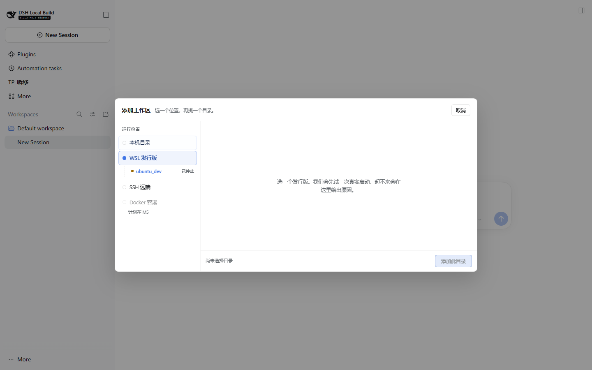

# dsh-remote-cr

[](https://github.com/CodingRookie98/dsh-remote-cr/actions/workflows/ci.yml)

> DeepSeek Harness（DSH）的远程开发插件：**把整个宿主搬到远端（WSL2 / SSH），本地只留一个原生 GUI 和钥匙。**
>
> 形态对标 VS Code Remote-SSH / Zed Remote —— 但搬过去的不是「命令」，是 agent 运行时本身。

| 瞬移面板：连接状态、投影工作区、会话 | 添加工作区：双栏工作台 |
|---|---|
|  |  |

截图来自真机 CDP 探针（1440×900），非示意图。

## 与「远端执行」类插件的区别

DSH 插件市场里的远程插件多为 **A 型（远端执行）**：agent、插件、会话、模型调用都在本地，只把命令与文件 IO 派发到远端。本项目是 **B 型（宿主远端）**：

| | A 型：远端执行 | B 型：宿主远端（本项目） |
|---|---|---|
| agent loop / 工具 / 会话 | 本地 | **远端** |
| 远端已装的 DSH 插件能被 agent 使用 | 否 | **是** |
| 关掉本地 GUI 后任务是否继续 | 否 | **是**（`keepAlive`，重连复用同一实例） |
| 真实 API key 落在哪 | 本地 | **本地**（远端只有占位令牌，调用经反向隧道回来替换） |

## 功能

**工作区入口** —— 占位官方 `directoryFlow`（侧栏与会话空态两个洞同时接管），保持单一原生 GUI
- 模态双栏：左栏来源（本机 / WSL 发行版 / SSH 远端 / Docker），右栏目录浏览器
- 面包屑 + 可编辑路径 + 上一级 + 刷新；`↑ ↓` 移动、`Enter` 进入、`Backspace` 上一级、`/` 跳路径框、`Esc` 关闭
- 不可用来源灰显并写明原因，修复命令一键复制（如 `wsl --install`）；Docker 为 M5 计划项，当前灰显

**WSL**
- 先唤醒再浏览：`wsl.exe -d <distro> --exec true` 探测通过才进目录；失败留在原地给诊断卡，不会把人丢进目录页
- 诊断卡包含错误码、人话说明、`Error code:` 原文、下一步与可复制的完整报告；冷启动超时单列 `wsl/timeout`
- 唤醒可取消：客户端 `abort` → 宿主 `close` → kill `wsl.exe`，不留跑满超时的孤儿进程

**SSH 与投影**
- 面板填目标并接入：远端注册工作区、投影会话回本地列表，与本地工作区同视图
- 断线自动重连（2s / 4s / 8s ×3 后退避到 2 分钟）；「结束远端」显式收掉远端进程
- 导入远端已有工作区：列出可导入项 → 选择 → 注册

**通用**
- 凭据不出本机：远端只持有占位令牌
- 失败一律结构化（`code` + `detail` + `nextActions`），可复制、可重试，不静默降级

## 要求

| 组件 | 支持范围 |
|---|---|
| DSH 宿主 | `>=0.2.1-rc.0 <0.3.0`（`package.json#engines.dsh`） |
| Node | `^22.19.0` 或 `>=24.0.0` |
| 本机 | Windows 10/11，WSL2 或 OpenSSH 客户端 |
| 远端 | Linux（POSIX shell + `node`；首次接入需在远端安装 dsh，可由引导器代做） |

## 安装

```bash
# 固定版本（推荐）
dsh plugin --profile web add 'github:CodingRookie98/dsh-remote-cr#v0.2.0'

# 或链接本地检出（开发）
dsh plugin --profile web add 'dsh-remote-cr@link:D:/workspace/projects/dsh-remote-cr'
```

装完重启 `dsh web`（或 DSH Desktop），侧栏出现「瞬移」即可使用。本包 `private: true`，通过 GitHub tag / 本地 link 分发，不走 npm publish。

## 使用

1. **接入远端**：打开「瞬移」面板 → 填 SSH 目标（或选 WSL 发行版）→ 接入。首次会分阶段显示引导进度，可取消。
2. **添加工作区**：点官方「Add workspace」，或面板里的添加入口 → 左栏选来源 → 右栏选目录 → 「添加此目录」。
3. **跑长任务**：会话运行在远端，关掉本地窗口任务继续；回来时重连复用同一实例，会话 id 不变。

## 工作原理

```
本地 GUI ──(投影 / 控制)──▶ 本地宿主半 ──(SSH 隧道 / WSL 调用)──▶ 远端 dsh 宿主
   │                          │                                      │
   └── 凭据代理 ◀─────────────┘          agent loop / 插件 / 会话 ◀───┘
```

- 四个入口，同一仓库：`./local`（本地宿主半）、`./client`（浏览器半）、`./companion`（远端伴生）、`./installer`（引导器）
- 宿主半提供 `/teleport/api/*` 路由（来源探测、目录浏览、唤醒、投影、接入与断连），全部只答本机回环
- **命名分层**：包名与插件 id 是 `dsh-remote-cr`；运行时标识保留 `teleport`（`~/.dsh-teleport`、`DSH_TELEPORT_*`、`/teleport` API 前缀、`data-teleport` DOM），改名不作废既有锚点与配置

## 开发

```bash
pnpm install
pnpm typecheck                     # 宿主半 + 浏览器半双 tsconfig
pnpm test                          # node --test（624 条）
pnpm build && pnpm build:client    # lib/ 是入库产物，改源码后必须重建
```

浏览器侧的两条 e2e 需要真 Chrome，**不进 CI**，本地跑：

```bash
pnpm e2e:preview    # 场景截图 + 键盘链路（Chrome headless）
pnpm e2e:host       # 真机：隔离 DSH_HOME + 真 dsh web + 真 Chrome（需 Windows + WSL2）
```

协作规则、提交分层与验收口径见 [`AGENTS.md`](./AGENTS.md)。

## 目录

```
src/
  client/      浏览器半：面板、添加工作区向导、状态机、样式
  local/       宿主半：路由、目录浏览、WSL/SSH 后端、投影、凭据代理
  shared/      两侧共享契约（线上形状只有一份）
  companion/   远端伴生
  installer/   引导器
scripts/       构建脚本与预览 harness
spikes/        可执行探针（CDP / 路径语义 / 跨机反向通路）
lib/           编译产物（入库，与源码分开提交）
docs/          调研、设计、决策、计划与审查归档
```

## 文档

- [文档索引](./docs/README.md)
- 设计：[需求与验收标准](./docs/design/requirements.md) · [总体架构](./docs/design/architecture.md) · [UI 设计](./docs/design/ui-design.md) · [里程碑](./docs/design/milestones.md)
- 决策：[ADR-0001](./docs/decisions/ADR-0001-host-on-remote.md)（B 型）· [ADR-0003](./docs/decisions/ADR-0003-embedding-strategy.md)（嵌入路线）· [ADR-0004](./docs/decisions/ADR-0004-plugin-sync.md)（插件同步）· [ADR-0005](./docs/decisions/ADR-0005-workspace-entry-ui.md)（工作区入口）
- 调研：[架构模型判定](./docs/research/01-architecture-models.md) · [竞品与生态](./docs/research/05-ecosystem-and-value-2026-11.md) · [DSH 扩展点与硬限制](./docs/research/04-dsh-extension-points.md)

## 已知限制

- **Docker**：界面灰显，实装排到 M5
- **浏览器**：只在 Chrome 上验证；Edge / Firefox / WebKit 未验证
- **无障碍**：读屏路径未验证（`radiogroup` / `listbox` 语义与键盘链路已实现并有断言）
- **真机时延**：唤醒成功路径的耗时分布未统计，只有失败归类与超时口径的真机证据

## 贡献

提交前确保 `pnpm typecheck` 与 `pnpm test` 全绿；`lib/` 产物单独提交（见 [`AGENTS.md`](./AGENTS.md) `4）。涉及契约或架构的改动先开 issue 讨论。

## 许可证

[MIT](./LICENSE) © 2026 dsh-remote-cr contributors
